<picture>
  <source media="(prefers-color-scheme: dark)" srcset="https://raw.githubusercontent.com/UbaidBinWaris/UbaidBinWaris/main/assets/hero-dark.svg">
  
</picture>

# Ubaid Bin Waris | Full-Stack Developer, AI & Backend Engineer

**I engineer the whole product.** Full-stack developer and backend engineer in Islamabad,
Pakistan, building Next.js and React products, Node.js, NestJS and Spring Boot backends,
AI agents, voice AI, n8n automation, PostgreSQL databases, CI/CD pipelines and the Linux
servers that keep everything running. Case studies, services and contact details live on
[ubaidbinwaris.com](https://ubaidbinwaris.com).

<p>
  <a href="https://ubaidbinwaris.com"></a>
  <a href="https://www.linkedin.com/in/ubaidbinwaris"></a>
  <a href="https://www.upwork.com/freelancers/~01d2f557e6c01a0296"></a>
  <a href="https://www.fiverr.com/ubaidwaris655"></a>
  <a href="https://discord.com/users/1194654569578373121"></a>
  <a href="mailto:ubaidwaris34@gmail.com"></a>
  <a href="https://ubaidbinwaris.com/resume.pdf"></a>
</p>

## 01 / Work: full-stack, AI and voice projects

Behind the interface. Inside the system. Six of the fifteen case studies from the
[engineering portfolio](https://ubaidbinwaris.com/#projects):

| Project | What it is | Stack | Status | Links |
|---|---|---|---|---|
| **Proxy QA Browser** | Free desktop app for testing website forms across real browsers, 226 emulated devices and US locations | Electron · React · TypeScript · Playwright · SQLite | Open source | [Case study](https://ubaidbinwaris.com/work/proxy-qa-browser) · [Website](https://proxybrowser.ubaidbinwaris.com) · [Code](https://github.com/UbaidBinWaris/proxy_browser) |
| **Orenyx Voice Dispatch** | Multi-tenant voice platform with an AI receptionist, IVR, call routing and live transfers | Plivo · ElevenLabs · PostgreSQL · Row-level security · Stripe · 2FA | Live | [Case study](https://ubaidbinwaris.com/work/orenyx-voice-dispatch) · [Product](https://orenyxvoicedispatch.com) · [Portal](https://portal.orenyxvoicedispatch.com) |
| **Sales Call Intelligence** | Local, GPU-accelerated pipeline that transcribes, diarizes and QA-scores sales calls at about 38× real time, with no cloud AI APIs | Python · FastAPI · NVIDIA NeMo · Parakeet TDT · Sortformer · Qwen3 8B · Ollama · CUDA | Public repo | [Case study](https://ubaidbinwaris.com/work/sales-call-intelligence) · [Code](https://github.com/UbaidBinWaris/qa_STT) |
| **Orenyx AI Assistant** | Standalone assistant for streaming chat, cited web research, PDF and Word analysis, and voice interaction | LLMs · RAG · Brave Search API · Speech-to-text · Text-to-speech | Private | [Case study](https://ubaidbinwaris.com/work/orenyx-ai-assistant) |
| **Scrap Exchange** | Scrap marketplace for Pakistan with photo-based AI price estimates, dealer offers and daily city rates, on Android and the web | Next.js · Kotlin · Jetpack Compose · Node.js · PostgreSQL · Prisma · Redis · YOLOv8 | Live | [Case study](https://ubaidbinwaris.com/work/scrap-exchange-valuation) · [Live](https://scrapex.ubaidbinwaris.com) · [Docs](https://docs.scrapex.ubaidbinwaris.com) |
| **Gixiai Website & Admin Panel** | SEO-optimized company website with a custom admin panel for blogs, portfolio, team and content | Next.js · React · PostgreSQL · REST APIs | Live | [Case study](https://ubaidbinwaris.com/work/gixiai-website) · [Website](https://www.gixiai.com) |

<details>
<summary><strong>The other nine case studies</strong></summary>
<br>

- [LetsScall Lead Generation Website](https://ubaidbinwaris.com/work/letsscall-website) — conversion-focused business website built to turn visitors into leads. WordPress, Elementor Pro, SEO. [Live](https://letsscall.com)
- [AI Video Automation from Telegram](https://ubaidbinwaris.com/work/telegram-ai-video-automation) — n8n pipeline that turns a Telegram voice message into a finished video. n8n, Telegram Bot API, ElevenLabs, FFmpeg, Google Drive.
- [Automated Short Video Generation](https://ubaidbinwaris.com/work/automated-short-video-generation) — batch pipeline that builds short videos from Google Sheets and Drive media, then writes status back to the sheet. n8n, FFmpeg, AI APIs.
- [Spring Boot on AWS: EC2, RDS & VPC](https://ubaidbinwaris.com/work/aws-spring-boot-deployment) — Spring Boot app on AWS with managed PostgreSQL, a custom VPC, reverse proxy and HTTPS. Spring MVC, Thymeleaf, Apache, Certbot.
- [Voice qualification & telephony](https://ubaidbinwaris.com/work/voice-qualification) — phone agent linking speech, lead qualification, CRM context and human handoff. LiveKit, Vapi, Deepgram, Node.js, Redis.
- [AI session coordination](https://ubaidbinwaris.com/work/ai-session-manager) — Node.js service coordinating concurrent AI sessions with job queues and explicit state transitions. Redis, BullMQ, JWT, Docker.
- [Lead intake & CRM automation](https://ubaidbinwaris.com/work/lead-automation) — event pipeline for webhook intake, AI qualification, database updates and team notifications. n8n, Node.js, PostgreSQL, Docker.
- [SEO & content workflow engine](https://ubaidbinwaris.com/work/seo-content-engine) — workflow for organizing content topics, generating structured metadata and managing indexing submissions. Next.js, model APIs, IndexNow, Python.
- [Local LLM inference workstation](https://ubaidbinwaris.com/work/local-llm-workstation) — Linux workstation running local model inference with Ollama in isolated service environments. HP Z840, Docker.

</details>

**See all 15 →** [Engineering portfolio](https://ubaidbinwaris.com/full-stack-developer-portfolio)

### Public code

- [**proxy_browser**](https://github.com/UbaidBinWaris/proxy_browser) — free, open-source desktop QA browser for testing your own website forms by US location (state, city, ZIP), emulated device and browser. Windows, Linux, macOS.
- [**qa_STT**](https://github.com/UbaidBinWaris/qa_STT) — local, GPU-accelerated sales call intelligence: Parakeet TDT v3 transcription, Sortformer diarization and LLM QA scoring.

## 02 / Expertise

One engineer across six connected domains: AI agents, voice AI, backend systems,
automation, infrastructure, and product and data.

| Domain | Stack |
|---|---|
| **AI Agents** | OpenAI & Claude APIs · Tool calling & MCP · Ollama local LLMs · RAG & vector search |
| **Voice AI** | LiveKit WebRTC · Vapi & Twilio · Deepgram STT · Cartesia TTS |
| **Backend Systems** | Node.js, NestJS, Express · Java & Spring Boot · BullMQ & RabbitMQ · REST & WebSockets |
| **Automation** | n8n · Trigger.dev · Webhook pipelines · Lead qualification |
| **Infrastructure** | Arch Linux · Docker & Compose · Nginx, Apache, Certbot · CI/CD & GitHub Actions |
| **Product & Data** | Next.js & React · PostgreSQL & Supabase · MongoDB & MySQL · TypeScript & Tailwind |

## 03 / Services: hire a full-stack, AI and voice developer

From the interface to the infrastructure. Each service below has its own page with the
approach, deliverables and tools.

| # | Service | What you get |
|---|---|---|
| 01 | [Custom AI Agent Development](https://ubaidbinwaris.com/ai-agent-development) | Agents with tool calling, retrieval and human approval, built for your workflows, APIs and business data. Node.js · Tool calling · RAG |
| 02 | [Voice AI & LiveKit Developer](https://ubaidbinwaris.com/voice-ai-developer) | Voice AI with LiveKit, Vapi and Twilio: call routing, CRM integration and human handoff. LiveKit · Vapi · Twilio |
| 03 | [n8n Automation Consultant](https://ubaidbinwaris.com/ai-automation-n8n) | Automation for CRMs, webhooks and AI workflows, with self-hosted deployments, retries and handover. n8n · Webhooks · PostgreSQL |
| 04 | [Node.js Backend & API Developer](https://ubaidbinwaris.com/backend-architecture) | APIs with PostgreSQL, Redis and queues, plus system architecture and integration. Node.js · PostgreSQL · Redis |
| 05 | [Linux & Cloud Infrastructure Engineer](https://ubaidbinwaris.com/infrastructure-devops) | Server setup, reverse proxies, backups and local LLM hosting, with documented handover. Linux · Docker · Nginx |
| 06 | [Next.js Developer](https://ubaidbinwaris.com/hire-nextjs-developer-pakistan) | App Router websites, SaaS interfaces and backend integration for remote teams. Next.js · React · TypeScript |

## 04 / About Ubaid Bin Waris

```text
$ uname -daily-driver
I use Arch, BTW.
● system stable
```

**// who_i_am** — I am Ubaid Bin Waris, a full-stack developer and backend engineer based in
Islamabad, Pakistan. I build complete products across React interfaces, APIs, databases,
AI systems, deployment pipelines, and Linux infrastructure.

**// what_i_do** — My backend work spans Node.js, NestJS, Express.js, Java and Spring Boot.
I also build production AI automation, LiveKit and Vapi voice agents, Redis-backed services,
and n8n workflows.

**// hardware** — Arch Linux has been my permanent daily driver for years. I also run a
dedicated HP Z840 dual-Xeon workstation with 96GB RAM for local LLM experiments and
self-hosted system testing.

**// philosophy** — Design for scale and resiliency. Use distributed locks for concurrent
workers, persistent queues for webhook retries, and strict isolation for production agent
environments.

## 05 / Experience

| When | Role | Where |
|---|---|---|
| Aug 2025 – Present | Senior Full Stack Developer | GixiAI |
| Jun 2025 – Jul 2025 | Web Developer | HH Tech Hub |
| Feb 2025 – May 2025 | Full Stack Developer | BluCentric |
| Jun 2023 – Aug 2023 | Intern | Higher Education Commission |

## 06 / Let's talk

Available for new projects: freelance, contract or full-time remote. Working worldwide
from Islamabad, Pakistan (UTC+5), with a typical reply within 24 hours.

- **Email:** ubaidwaris34@gmail.com
- **Hire:** [Upwork](https://www.upwork.com/freelancers/~01d2f557e6c01a0296) · [Fiverr](https://www.fiverr.com/ubaidwaris655)
- **Connect:** [LinkedIn](https://www.linkedin.com/in/ubaidbinwaris) · [Discord](https://discord.com/users/1194654569578373121)
- **Start a project →** [ubaidbinwaris.com/#contact](https://ubaidbinwaris.com/#contact)
